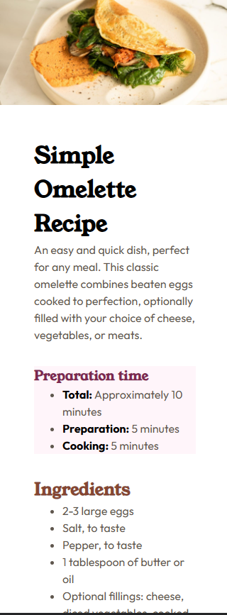

# Frontend Mentor - Recipe page solution

This is a solution to the [Recipe page challenge on Frontend Mentor](https://www.frontendmentor.io/challenges/recipe-page-KiTsR8QQKm). Frontend Mentor challenges help you improve your coding skills by building realistic projects.

## Table of contents

- [Overview](#overview)
  - [The challenge](#the-challenge)
  - [Screenshot](#screenshot)
  - [Links](#links)
- [My process](#my-process)
  - [Built with](#built-with)
  - [What I learned](#what-i-learned)
  - [Continued development](#continued-development)
  - [Useful resources](#useful-resources)
  - [AI Collaboration](#ai-collaboration)
- [Author](#author)
- [Acknowledgments](#acknowledgments)

**Note: Delete this note and update the table of contents based on what sections you keep.**

## Overview

a simply single static page website.

### Screenshot

### Links

- Solution URL: [github-code] (https://github.com/farazpc3/recipe-page-frontend-mentor)
- Live Site URL: [github-page](https://farazpc3.github.io/recipe-page-frontend-mentor)

## My process

### Built with

- HTML5
- CSS

### What I learned

I've learned that different projects require much different approach as this project didn't even have a header or footer.

### Continued development

I just want more and more. I'm so newbie T_T

### Useful resources

- [Example resource 1] MDN - always my n1 resource for html,css,js
- [Example resource 2] chatbots for asking questions.

### AI Collaboration

I use AI but I hate just copy pasting stuff. I like to use it for asking questions and getting better suggestions, for example I used it for classname selections as I'm not good at BEM approach.

## Author

- Website - [Mila](https://farazcv.vercel.app)
- Frontend Mentor - [@farazpc3](https://www.frontendmentor.io/profile/farazpc3)

## Acknowledgments

I did this on my own.
